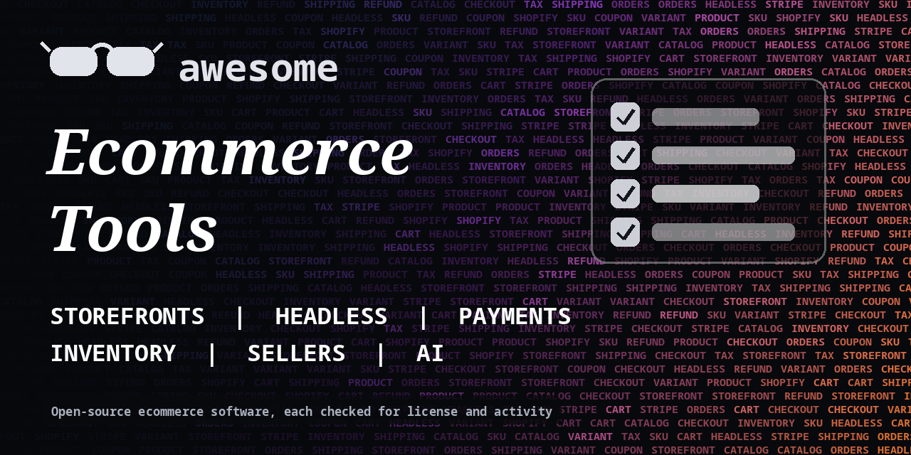

<h1 align="center">Awesome Ecommerce Tools</h1>

> Open-source storefronts, headless commerce engines, payments, inventory, marketplaces and seller tools for online stores. Every entry shows its license.

**Rules of this list:** every repo exists, is public, is not archived, states a license and has had a commit in the last year. One plain sentence each. Star counts and claims are the authors' own, we did not test every tool. Checked 2026-10-18. See [CONTRIBUTING.md](CONTRIBUTING.md).

## Contents

- [Full ecommerce platforms](#full-ecommerce-platforms)
- [Headless commerce and APIs](#headless-commerce-and-apis)
- [Storefront templates and front ends](#storefront-templates-and-front-ends)
- [Shopify and marketplace tooling](#shopify-and-marketplace-tooling)
- [Payments and checkout](#payments-and-checkout)
- [Inventory, orders and fulfillment](#inventory-orders-and-fulfillment)
- [Seller tools and research](#seller-tools-and-research)
- [AI for ecommerce](#ai-for-ecommerce)
- [Analytics and conversion](#analytics-and-conversion)
- [How to choose](#how-to-choose)
- [Contributing](#contributing)

## Full ecommerce platforms

Complete shops you can host yourself.

- [aimeos/aimeos-laravel](https://github.com/aimeos/aimeos-laravel)  - Laravel ecommerce package for shops and marketplaces. _(MIT)_
- [akeneo/pim-community-dev](https://github.com/akeneo/pim-community-dev)  - Open-source product information management (PIM) for product catalogs. _(check repo)_
- [bagisto/bagisto](https://github.com/bagisto/bagisto)  - Open-source ecommerce and multi-vendor marketplace platform built on Laravel. _(MIT)_
- [evershopcommerce/evershop](https://github.com/evershopcommerce/evershop)  - TypeScript ecommerce platform with a built-in storefront and admin. _(GPL-3.0)_
- [magento/magento2](https://github.com/magento/magento2)  - Magento Open Source ecommerce platform in PHP. _(OSL-3.0)_
- [medusajs/medusa](https://github.com/medusajs/medusa)  - Open-source commerce modules and tools for building custom digital commerce. _(check repo)_
- [nopSolutions/nopCommerce](https://github.com/nopSolutions/nopCommerce)  - Open-source ecommerce platform on ASP.NET Core. _(check repo)_
- [PrestaShop/PrestaShop](https://github.com/PrestaShop/PrestaShop)  - Open-source ecommerce platform written in PHP. _(check repo)_
- [saleor/saleor](https://github.com/saleor/saleor)  - Composable headless commerce API built with Python and GraphQL. _(BSD-3-Clause)_
- [shopware/shopware](https://github.com/shopware/shopware)  - Open-source ecommerce platform in PHP, with a headless API. _(MIT)_
- [solidusio/solidus](https://github.com/solidusio/solidus)  - Open-source ecommerce framework for Ruby on Rails. _(BSD-3-Clause)_
- [spree/spree](https://github.com/spree/spree)  - Open-source commerce platform for direct-to-consumer, B2B and marketplaces. _(BSD-3-Clause)_
- [Sylius/Sylius](https://github.com/Sylius/Sylius)  - Headless ecommerce platform on PHP and Symfony. _(MIT)_
- [unopim/unopim](https://github.com/unopim/unopim)  - Open-source product information management for catalog data. _(MIT)_
- [vendurehq/vendure](https://github.com/vendurehq/vendure)  - Headless commerce platform built with TypeScript and NestJS. _(check repo)_
- [woocommerce/woocommerce](https://github.com/woocommerce/woocommerce)  - Ecommerce plugin for WordPress. _(check repo)_

## Headless commerce and APIs

Back ends you connect to your own front end.

- [lunarphp/lunar](https://github.com/lunarphp/lunar)  - Laravel package for headless ecommerce. _(MIT)_
- [mercurjs/mercur](https://github.com/mercurjs/mercur)  - Open-source marketplace platform on top of Medusa. _(MIT)_

## Storefront templates and front ends

Starter stores and UI kits.

- [saleor/storefront](https://github.com/saleor/storefront)  - Next.js storefront for Saleor. _(check repo)_
- [Shopify/hydrogen](https://github.com/Shopify/hydrogen)  - Shopify's React framework for custom storefronts. _(MIT)_
- [vercel/commerce](https://github.com/vercel/commerce)  - Next.js ecommerce template for building a storefront. _(MIT)_

## Shopify and marketplace tooling

Apps, themes and SDKs for Shopify, WooCommerce and others.

- [Shopify/cli](https://github.com/Shopify/cli)  - Command-line tool to build Shopify apps, themes and Hydrogen storefronts. _(MIT)_
- [Shopify/dawn](https://github.com/Shopify/dawn)  - Shopify's reference theme. _(check repo)_
- [Shopify/shopify-app-template-node](https://github.com/Shopify/shopify-app-template-node)  - Starter template for a Shopify app with Node.js. _(MIT)_
- [Shopify/themekit](https://github.com/Shopify/themekit)  - Command-line tool for Shopify theme development. _(MIT)_

## Payments and checkout

Take payments, handle tax and invoices.

- [btcpayserver/btcpayserver](https://github.com/btcpayserver/btcpayserver)  - Self-hosted Bitcoin payment processor with no fees. _(MIT)_
- [getlago/lago](https://github.com/getlago/lago)  - Open-source usage-based billing and metering API. _(AGPL-3.0)_
- [invoiceninja/invoiceninja](https://github.com/invoiceninja/invoiceninja)  - Invoicing, quotes and payments for small businesses. _(check repo)_
- [juspay/hyperswitch](https://github.com/juspay/hyperswitch)  - Open-source payments switch that routes across processors. _(Apache-2.0)_
- [killbill/killbill](https://github.com/killbill/killbill)  - Open-source subscription billing and payments platform. _(Apache-2.0)_
- [stripe/stripe-node](https://github.com/stripe/stripe-node)  - Official Stripe library for Node.js. _(MIT)_
- [stripe/stripe-python](https://github.com/stripe/stripe-python)  - Official Stripe library for Python. _(MIT)_

## Inventory, orders and fulfillment

Stock, warehouses and shipping.

- [EasyPost/easypost-python](https://github.com/EasyPost/easypost-python)  - Official Python client for EasyPost shipping. _(MIT)_
- [frappe/erpnext](https://github.com/frappe/erpnext)  - Open-source ERP with inventory, orders and accounting. _(GPL-3.0)_
- [inventree/InvenTree](https://github.com/inventree/InvenTree)  - Open-source inventory management system. _(MIT)_
- [odoo/odoo](https://github.com/odoo/odoo)  - Open-source business apps including ecommerce, inventory and accounting. _(check repo)_

## Seller tools and research

Price tracking, listing and marketplace helpers.

- [amzn/selling-partner-api-models](https://github.com/amzn/selling-partner-api-models)  - Official models for Amazon's Selling Partner API. _(Apache-2.0)_
- [dgtlmoon/changedetection.io](https://github.com/dgtlmoon/changedetection.io)  - Watch web pages for changes and price drops, self-hosted. _(Apache-2.0)_
- [YosefHayim/ebay-mcp](https://github.com/YosefHayim/ebay-mcp)  - Local MCP server that connects AI assistants to eBay seller APIs. _(MIT)_

## AI for ecommerce

Search, recommendations and assistants for stores.

- [meilisearch/meilisearch](https://github.com/meilisearch/meilisearch)  - Fast open-source search engine, often used for product search. _(check repo)_
- [querqy/chorus](https://github.com/querqy/chorus)  - Open-source stack for ecommerce search. _(Apache-2.0)_
- [typesense/typesense](https://github.com/typesense/typesense)  - Fast open-source search engine with typo tolerance, used for product search. _(GPL-3.0)_

## Analytics and conversion

Measure funnels and test changes.

- [growthbook/growthbook](https://github.com/growthbook/growthbook)  - Feature flags and A/B testing with a warehouse-native approach. _(check repo)_
- [openreplay/openreplay](https://github.com/openreplay/openreplay)  - Session replay and product analytics you can self-host. _(check repo)_
- [plausible/analytics](https://github.com/plausible/analytics)  - Simple, privacy-friendly web analytics. _(AGPL-3.0)_
- [PostHog/posthog](https://github.com/PostHog/posthog)  - Product analytics, session replay and feature flags. _(check repo)_
- [umami-software/umami](https://github.com/umami-software/umami)  - Privacy-focused web analytics. _(MIT)_

## How to choose

- **Hosted or self-hosted?** Self-hosting is cheaper but you handle security, updates and PCI rules.
- **Check the license.** Some engines are free for small shops and paid for large revenue.
- **Do not store card numbers yourself.** Use a payment provider's hosted fields.
- **Test the checkout** with real small orders before you launch.

## Contributing

See [CONTRIBUTING.md](CONTRIBUTING.md). One entry per pull request, plain words, real sources only.

## About

Maintained by [@devanasolver](https://github.com/devanasolver). Listings follow the rules in CONTRIBUTING.

## Sponsor me

If this list is useful, [buy me a coffee](https://buymeacoffee.com/isaac49).
